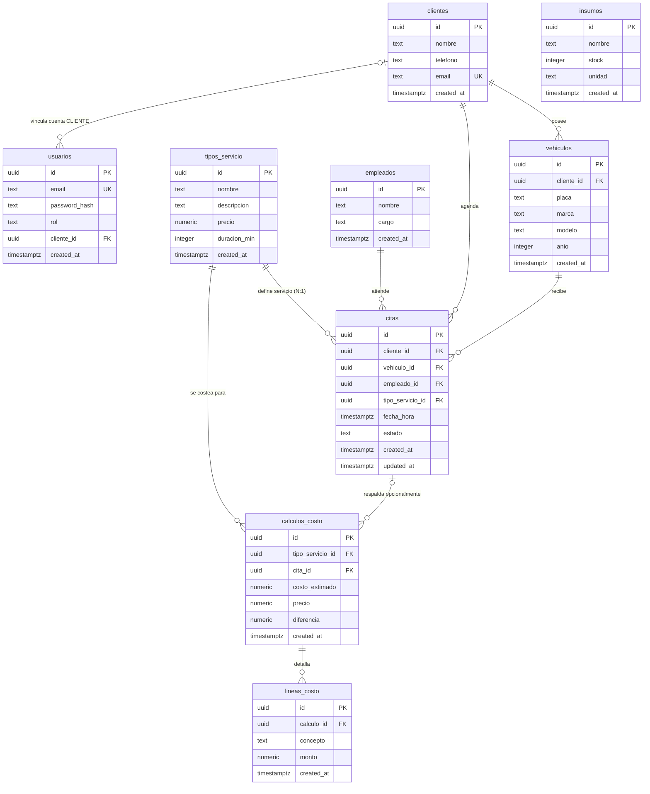

# Modelo Entidad-Relación (ERD) — AutoClean

> Cardinalidad citas↔servicios: Opción A (N:1), decidida en `docs/decision-citas-servicios.md`. No existe tabla `cita_servicios`.

## Diagrama ER

## Explicación de llaves foráneas (`FOREIGN KEY`) y políticas `ON DELETE`

- `vehiculos.cliente_id → clientes(id)` (`ON DELETE RESTRICT`): todo vehículo pertenece obligatoriamente a un cliente; `RESTRICT` impide borrar un cliente mientras conserve vehículos registrados.
- `citas.cliente_id → clientes(id)` (`ON DELETE RESTRICT`): vincula la cita con el cliente que solicita el servicio; `RESTRICT` protege el historial de citas y reportes por periodo.
- `citas.vehiculo_id → vehiculos(id)` (`ON DELETE RESTRICT`): identifica el vehículo específico atendido en el turno; `RESTRICT` evita eliminar vehículos con citas históricas.
- `citas.empleado_id → empleados(id)` (`ON DELETE RESTRICT`): asigna el empleado responsable del turno; `RESTRICT` impide eliminar empleados que ya tienen citas asociadas.
- `citas.tipo_servicio_id → tipos_servicio(id)` (`ON DELETE RESTRICT`): materializa la Opción A (N:1, un servicio por cita sin tabla `cita_servicios`); `RESTRICT` impide borrar servicios usados en citas existentes.
- `calculos_costo.tipo_servicio_id → tipos_servicio(id)` (`ON DELETE RESTRICT`): todo cálculo toma como referencia el precio de un tipo de servicio; `RESTRICT` protege los servicios con estimaciones registradas.
- `calculos_costo.cita_id → citas(id)` (`ON DELETE SET NULL`): relaciona opcionalmente una estimación con una cita concreta (`appointmentId` opcional); `SET NULL` conserva el registro contable del costeo si la cita se elimina.
- `lineas_costo.calculo_id → calculos_costo(id)` (`ON DELETE CASCADE`): agrupa los rubros de costo bajo su estimación cabecera; `CASCADE` elimina automáticamente las líneas huérfanas al borrar el cálculo padre.
- `usuarios.cliente_id → clientes(id)` (`ON DELETE SET NULL`): enlaza únicamente a los usuarios con rol `CLIENTE` con su ficha en `clientes`; `SET NULL` permite desvincular la referencia sin destruir el usuario si el cliente se elimina.

